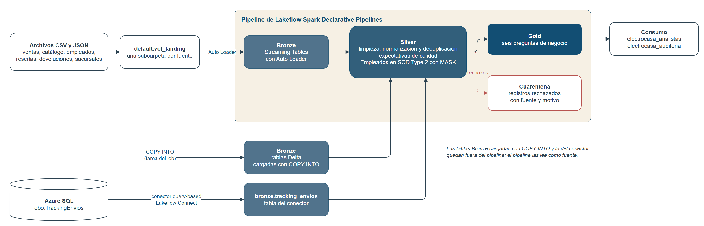
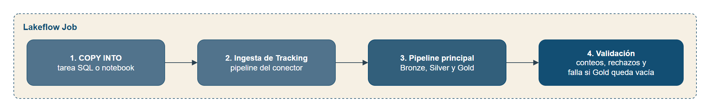

# ElectroCasa Lakehouse

Plataforma de datos de punta a punta sobre **Azure Databricks** para ElectroCasa, una cadena de 40 tiendas de electrodomésticos en Perú. Integra seis fuentes heterogéneas (ventas, catálogo, RR.HH., reseñas, devoluciones y el tracking del courier) en un modelo Medallion con Lakeflow Spark Declarative Pipelines, orquestado con Lakeflow Jobs, gobernado con Unity Catalog y desplegado con un Declarative Automation Bundle.

> Proyecto Integrador · Databricks Data Engineer Associate · Edición 15.
> Los datos, sucursales y personas son ficticios.

## Contenido

1. [El caso y las preguntas de negocio](#1-el-caso-y-las-preguntas-de-negocio)
2. [Arquitectura](#2-arquitectura)
3. [Estructura del repositorio](#3-estructura-del-repositorio)
4. [Ingesta: método por fuente](#4-ingesta-método-por-fuente)
5. [Silver: limpieza, calidad y cuarentena](#5-silver-limpieza-calidad-y-cuarentena)
6. [Historización de Empleados (SCD Type 2)](#6-historización-de-empleados-scd-type-2)
7. [Gold: una tabla por pregunta](#7-gold-una-tabla-por-pregunta)
8. [Decisiones de diseño](#8-decisiones-de-diseño)
9. [Orquestación](#9-orquestación)
10. [CI/CD con el bundle](#10-cicd-con-el-bundle)
11. [Gobierno y seguridad](#11-gobierno-y-seguridad)
12. [Monitoreo y costos](#12-monitoreo-y-costos)
13. [Despliegue paso a paso](#13-despliegue-paso-a-paso)
14. [Evidencia de ejecución](#14-evidencia-de-ejecución)
15. [Antipatrones evitados](#15-antipatrones-evitados)
16. [Reto opcional: cuarentena con trazabilidad completa](#16-reto-opcional-cuarentena-con-trazabilidad-completa)

---

## 1. El caso y las preguntas de negocio

Hoy ElectroCasa no tiene una fuente única de verdad: cada sucursal exporta sus ventas, RR.HH. lleva su propio sistema, las reseñas se leen a mano y el seguimiento de despachos vive en la base del courier. La capa Gold responde estas seis preguntas para el período **marzo a octubre de 2026**, siempre con datos de Silver (limpios y deduplicados; los rechazados no cuentan):

| # | Pregunta | Tabla Gold |
|---|---|---|
| 1 | Ventas, devoluciones, ventas netas, cantidad de ventas y ticket promedio por sucursal y mes | `gold.ventas_netas_sucursal_mes` |
| 2 | Top 10 por unidades y top 10 por tasa de devolución | `gold.top_productos_unidades`, `gold.top_productos_tasa_devolucion` |
| 3 | Empleados activos por sucursal al cierre de cada mes | `gold.dotacion_sucursal_mes` |
| 4 | Ventas de tienda física por vendedor, con la sucursal que tenía **en la fecha de la venta** | `gold.ventas_vendedor_sucursal_mes` |
| 5 | % de reseñas negativas (1 o 2) por categoría y mes | `gold.resenas_negativas_categoria_mes` |
| 6 | Horas promedio de entrega y % de devueltos por courier | `gold.despachos_courier` |

Las consultas que responden cada pregunta están en [`notebooks/06_preguntas_de_negocio.ipynb`](notebooks/06_preguntas_de_negocio.ipynb).

## 2. Arquitectura



```
 Volume de landing                      Lakeflow Spark Declarative Pipeline (serverless, triggered)
 /Volumes/<cat>/default/vol_landing/   ┌─────────────────────────────────────────────────────────────┐
   ventas/        ── Auto Loader ────▶ │ bronze.ventas          ─▶ silver.ventas        ─┐            │
   empleados/     ── Auto Loader ────▶ │ bronze.empleados       ─▶ silver.empleados_eventos ─▶ silver.empleados (SCD2)
   devoluciones/  ── Auto Loader ────▶ │ bronze.devoluciones    ─▶ silver.devoluciones   ─┤            │
   resenas/       ── Auto Loader ────▶ │ bronze.resenas         ─▶ silver.resenas        ─┼─▶ gold.*   │
   catalogo/   ┐                       │                                                │  (7 tablas) │
   sucursales/ ┴─ COPY INTO (job) ──▶  │ bronze.catalogo / bronze.sucursales ─▶ silver.catalogo / silver.sucursales
 Azure SQL dbo.TrackingEnvios          │                                                │            │
   ── Lakeflow Connect (query-based) ▶ │ bronze.tracking_envios ─▶ silver.tracking_envios ┘            │
                                       │ Todas las vistas preparadas ─▶ silver.cuarentena             │
                                       └─────────────────────────────────────────────────────────────┘
```

| Capa | Qué guarda | Tipo de objeto |
|---|---|---|
| **Bronze** | Los datos tal como llegan, todo en texto, más `_archivo_origen`, `_lote` y `_fecha_ingesta` (y `_rescued_data` en Auto Loader). Sin limpieza, filtros ni cálculos. | Streaming Tables (Auto Loader); tablas Delta de COPY INTO; tabla destino del conector |
| **Silver** | Tipos de negocio, valores estandarizados, sin reingestas, con expectativas de calidad y la tabla de cuarentena. Empleados historizado como SCD2. | Materialized Views |
| **Gold** | Una tabla por pregunta de negocio, más `empleados_vigentes` (enmascarada). | Materialized Views |

**Por qué Silver y Gold son Materialized Views:** las reglas necesitan ver toda la historia, no solo el lote nuevo: deduplicar reingestas que llegan un lote después, validar devoluciones contra todas las ventas y rearmar la historia de Empleados cuando llega un evento tardío. El volumen es chico (decenas de miles de filas), así que recalcular es barato, y en serverless Databricks refresca incrementalmente cuando puede.

## 3. Estructura del repositorio

```
electrocasa-lakehouse/
├── databricks.yml                       # bundle: variables y targets dev / prod
├── resources/
│   ├── electrocasa_pipeline.yml         # pipeline declarativo (serverless, triggered)
│   └── electrocasa_job.yml              # job de 4 tareas, trigger por llegada de archivo, alertas
├── src/electrocasa/
│   ├── transformations/
│   │   ├── bronze/bronze_auto_loader.py
│   │   ├── silver/silver_ventas_devoluciones.py
│   │   ├── silver/silver_catalogo_sucursales.py
│   │   ├── silver/silver_empleados.py
│   │   ├── silver/silver_resenas_tracking.py
│   │   ├── silver/silver_cuarentena.py
│   │   ├── gold/gold_preguntas.py
│   │   └── gold/gold_empleados.py
│   └── utils/
│       ├── config.py                    # catálogo y rutas según el target
│       ├── esquemas.py                  # esquemas explícitos de Bronze
│       ├── normalizacion.py             # fechas, montos, mapas de valores cerrados
│       └── calidad.py                   # reglas de calidad (una sola fuente de verdad) y cuarentena
├── contratos/                           # un contrato de datos por fuente
├── notebooks/
│   ├── 00_setup.ipynb                   # catálogo, schemas, volume, tablas de COPY INTO, máscaras, GRANTs
│   ├── 01_copy_into_bronze.ipynb        # tarea 1 del job
│   ├── 02_validacion.ipynb              # tarea 4 del job
│   ├── 03_gobierno_revoke_y_auditoria.ipynb
│   ├── 04_monitoreo.ipynb
│   ├── 05_verificacion_masking.ipynb
│   └── 06_preguntas_de_negocio.ipynb
├── tests/test_normalizacion.py          # pytest de las normalizaciones, sin Databricks
└── docs/                                # diagramas y capturas de evidencia
```

La lógica de limpieza se prueba fuera del runtime: `pip install pyspark==4.0.1 pytest && pytest tests/` (29 pruebas: fechas, montos, precios y los mapas de valores cerrados).

## 4. Ingesta: método por fuente

| Fuente | Método | Por qué |
|---|---|---|
| Ventas | **Auto Loader** en el pipeline | Lotes incrementales, la fuente más grande y la que más crece. Auto Loader recuerda qué archivos ya leyó y el pipeline gestiona el checkpoint. |
| Empleados | **Auto Loader** en el pipeline | Lotes de eventos nuevos (incluidos eventos tardíos). Bronze solo agrega; la historia se arma en Silver. |
| Devoluciones | **Auto Loader** en el pipeline | Mismo patrón que Ventas: lotes incrementales. |
| Reseñas | **Auto Loader** en el pipeline | JSON Lines anidado; esquema explícito (`tags` array, `respuestas` array de structs, `metadata` texto JSON) y `_rescued_data` para campos inesperados. |
| Catálogo | **COPY INTO** en una tarea del job | Snapshots **completos** y muy pocos (2). COPY INTO es idempotente, corre en SQL y permite recargar un snapshot puntual. `multiLine` + `primitivesAsString`. |
| Sucursales | **COPY INTO** en una tarea del job | Un solo archivo de referencia de 40 filas que casi no cambia. |
| Tracking | **Conector query-based de SQL Server (Lakeflow Connect)** | Obligatorio. Cursor `fecha_modificacion`, llave `evento_id`, modo SCD Type 1. Credenciales en la Connection de UC `conn_electrocasa_tracking`. |

**COPY INTO va fuera del pipeline** (no se puede declarar dentro de uno): la tarea `copy_into_bronze` carga `bronze.catalogo` y `bronze.sucursales`, y el pipeline las lee en batch desde Materialized Views.

**Columnas de auditoría en Bronze:** `_archivo_origen` (`_metadata.file_name`), `_lote` (`lote_01`, `2026-03-01`, ...), `_fecha_ingesta` (`current_timestamp()`). Bronze no se particiona por fechas de negocio.

### Exploración de Tracking

Antes de ingerir, la tabla se exploró desde el catálogo foráneo `electrocasa_sqlserver` (Lakehouse Federation):

```sql
SELECT estado_entrega, count(*) FROM electrocasa_sqlserver.dbo.TrackingEnvios GROUP BY 1 ORDER BY 2 DESC;
SELECT courier, count(*)        FROM electrocasa_sqlserver.dbo.TrackingEnvios GROUP BY 1 ORDER BY 2 DESC;
-- mensajes reprocesados: mismo envío y mismo estado con más de un evento_id
SELECT tracking_id, lower(estado_entrega) AS estado, count(*) AS eventos
FROM electrocasa_sqlserver.dbo.TrackingEnvios GROUP BY 1, 2 HAVING count(*) > 1;
```

> **Completar:** pega el resultado y, si aparece una escritura de estado que no está en `ESTADOS_ENTREGA` (`src/electrocasa/utils/normalizacion.py`), agrégala ahí y en `contratos/tracking_envios.yml`. Las filas con estados desconocidos quedan en `silver.cuarentena` con su valor original.

## 5. Silver: limpieza, calidad y cuarentena

Cada fuente sigue el mismo patrón:

1. **Vista temporal `*_preparadas`**: normaliza tipos y valores, deduplica reingestas, marca referencias huérfanas y guarda la fila original de Bronze en `_raw`.
2. **Tabla Silver**: lee la vista y aplica las expectativas.
3. **`silver.cuarentena`**: lee las mismas vistas y guarda todo lo que violó una regla.

Las reglas se declaran **una sola vez** en [`utils/calidad.py`](src/electrocasa/utils/calidad.py). De ahí salen las expectativas (`dp.expect_all_or_drop` / `dp.expect_all`), las filas de cuarentena y los nombres que usa cada contrato, así que código y contrato no se pueden desalinear.

### Normalizaciones

| Problema | Ejemplo | Solución |
|---|---|---|
| Fechas en varios formatos | `2026-06-07`, `07/06/2026`, `2026-06-07T14:30:00` | `try_to_date` / `try_to_timestamp` en cascada (no fallan con ANSI) |
| Coma decimal y punto de miles | `1.234,50` | si hay coma: se quitan los puntos y la coma pasa a punto |
| Precio como texto con moneda | `S/ 1,299.90` | se quita `S/` y la coma de miles |
| Métodos de pago | 17 escrituras (`TC`, `td`, `EFV`, `TRF`, `Yape`...) | mapa a `tarjeta`, `efectivo`, `yape`, `plin`, `transferencia` |
| Categorías | 17 escrituras (`Línea blanca`, `LINEA BLANCA`, `linea_blanca`...) | minúsculas + sin tildes + mapa a 5 valores |
| Tipos de evento | 13 escrituras, `cese` = baja | mapa a `alta`, `transferencia`, `cambio_salario`, `baja` |
| Estados de entrega y couriers | `En camino`, `EN_CAMINO`, `en_transito` | mapa a 4 estados; courier con `initcap` |
| Ciudad en Sucursales | `AREQUIPA` | `initcap` |
| Reingestas | ventas, devoluciones y reseñas repetidas en el lote siguiente | `row_number` por llave, se conserva la primera llegada |
| Productos repetidos en el snapshot de marzo | 25 productos con 2 precios | un producto por fila: último snapshot, precio válido y mayor |

### Expectativas y política de violación

| Fuente | Regla | Política | Por qué |
|---|---|---|---|
| Ventas | `monto_positivo`: `monto_total > 0` (después de normalizar) | **drop** | Es la medida de las preguntas 1 y 4. Son ~2% de filas: no justifica frenar todo el lote. |
| Ventas | `cantidad_positiva`, `sucursal_informada`, `fecha_valida`, `metodo_pago_conocido`, `canal_conocido` | drop | Sin esos datos la venta no se puede asignar a sucursal, mes o canal. |
| Ventas | `producto_en_catalogo` | **warn** | La venta existió y cuenta en ventas netas; solo le falta el maestro. |
| Catálogo | `precio_valido`: `precio_lista > 0` | **warn** | El precio no se usa en ninguna pregunta; descartar el producto dejaría huérfanas sus ventas y reseñas. |
| Catálogo | `categoria_conocida` | drop | La pregunta 5 agrupa por categoría. |
| Empleados | `evento_ubicable`: `id_empleado` y `fecha_evento` no nulos | **drop** | Sin ellos no se puede ubicar el evento en la historia. No es fail: son 38 de 4.448 filas. `NOT NULL` en el schema no frena una llave nula: la expectativa sí. |
| Empleados | `dni_informado`, `dni_unico`, `salario_en_rango` | warn | No afectan dotación ni ventas por vendedor. |
| Reseñas | `calificacion_en_escala`: 1 a 5 | **drop** | El enunciado excluye las calificaciones inválidas del cálculo. |
| Reseñas | `producto_en_catalogo` | drop | Sin producto no hay categoría (el enunciado también la excluye). |
| Devoluciones | `reembolso_valido`: `0 <= monto_reembolso <= monto_venta` | **drop** | Se resta de las ventas: uno negativo o mayor que la venta distorsiona las ventas netas. La regla compara columnas de la misma fila porque el join con Ventas se hace antes, en la vista. |
| Devoluciones | `venta_existe` | drop | Sin la venta no se puede validar el reembolso. |
| Tracking | `estado_conocido`: estado en `{pendiente, en_transito, entregado, devuelto}` | **drop** | Las métricas de la pregunta 6 dependen del estado. |
| Tracking | `venta_existe` | warn | El envío existió; la métrica del courier no necesita la venta. |

Ninguna regla usa `fail`: todas las fuentes tienen errores esperables y conocidos, y frenar el pipeline por una fila dejaría sin actualizar las demás fuentes. Lo crítico se descarta y queda consultable en cuarentena.

## 6. Historización de Empleados (SCD Type 2)

Las preguntas 3 y 4 necesitan saber en qué sucursal estaba un empleado en una fecha pasada. Un ejemplo real de los datos:

| Evento | fecha_evento | Sucursal |
|---|---|---|
| alta | 2023-04-28 | S35 |
| transferencia | 2026-04-11 | S21 |
| transferencia | 2026-07-27 | S31 |

`EMP-01402` vendió el 9 de abril en tienda física. Con SCD Type 1 esa venta quedaría en S31 (donde trabaja hoy); con SCD Type 2 queda en **S35**, que es donde estaba ese día. En la ejecución de prueba, `gold.ventas_vendedor_sucursal_mes` reparte su abril así: 2 ventas en S35 (antes del 11) y 2 en S21 (después), y desde octubre sus ventas caen en S31.

**Implementación: intervalos armados a mano** en la Materialized View `silver.empleados`:

```python
orden = Window.partitionBy("id_empleado").orderBy("fecha_evento", "fecha_registro")
valido_hasta = F.lead("fecha_evento").over(orden)
# cada evento que no es baja abre una versión; una baja solo cierra la anterior
```

- **Orden de los cambios:** `fecha_evento` (cuándo ocurrió) y, para desempatar, `fecha_registro` (cuándo lo cargó RR.HH.). Nunca `current_timestamp()`.
- **Dos eventos el mismo día** (38 casos): `fecha_registro` decide cuál fue primero. El primero queda con un intervalo vacío `[d, d)` y vale el segundo.
- **Llegada tardía** (63 eventos de junio a agosto registrados en octubre, en el lote 3): como `silver.empleados` se recalcula con todos los eventos, el evento tardío queda en su lugar y corta la versión que seguía abierta.
- **Vigencia:** una versión vale en `[valido_desde, valido_hasta)`; `valido_hasta = NULL` es la versión actual.

**Por qué no AUTO CDC:** AUTO CDC necesita una sola columna `sequence_by`. Aquí el orden real sale de dos columnas (`fecha_evento`, `fecha_registro`); con un struct como secuencia, `__START_AT` / `__END_AT` quedan como struct y hay que declararlos igual en el schema de la tabla con `MASK`. Los intervalos a mano hacen explícita la regla de vigencia, que es justo lo que usan las preguntas 3 y 4.

## 7. Gold: una tabla por pregunta

| Tabla | Cómo se calcula |
|---|---|
| `ventas_netas_sucursal_mes` | Ventas por (`sucursal_id`, mes de `fecha_venta`) en **full outer join** con devoluciones por (`sucursal_id`, mes de `fecha_devolucion`). Ventas netas = ventas − devoluciones. Ticket promedio = ventas / `count(distinct venta_id)` (sin restar devoluciones). |
| `top_productos_unidades` | `sum(cantidad)` por producto; `row_number` con desempate por cantidad de ventas y `producto_id`. |
| `top_productos_tasa_devolucion` | `count(distinct devolucion_id) / count(distinct venta_id)` por producto. |
| `dotacion_sucursal_mes` | Para cada cierre de mes (`last_day` de marzo a octubre), empleados con una versión donde `valido_desde <= cierre` y (`valido_hasta` nulo o `> cierre`). Una baja el mismo día del cierre ya no cuenta. |
| `ventas_vendedor_sucursal_mes` | Ventas de `tienda_fisica` unidas con la historia por `vendedor_id` y `valido_desde <= fecha_venta < valido_hasta`. Sin versión vigente → `SIN_ASIGNAR`. |
| `resenas_negativas_categoria_mes` | Reseñas válidas unidas con la categoría de `silver.catalogo` (último snapshot del producto). `% = reseñas con calificación ≤ 2 / total`. |
| `despachos_courier` | Por envío: primer `pendiente`, primer `entregado`, si hubo `devuelto`. Por courier: horas promedio (solo entregados) y % devueltos sobre envíos en estado final. |
| `empleados_vigentes` | Versión vigente de cada empleado, con `MASK` en `dni` y `salario` (para la demostración del masking). |

## 8. Decisiones de diseño

| Decisión | Elección | Justificación |
|---|---|---|
| Ventas con producto inexistente | Se conservan (warn) | El dinero entró: cuenta en ventas netas. En los rankings de productos aparecen sin nombre. |
| Devoluciones con venta vacía o inexistente | Se descartan a cuarentena | No se puede comprobar que el reembolso no supere la venta. |
| Reseñas con producto inexistente | Se descartan a cuarentena | El enunciado las excluye de la pregunta 5. |
| Tracking con venta inexistente | Se conserva (warn) | El envío existió; la métrica del courier no depende de la venta. |
| Mismo `dni` en dos empleados | Se conservan los dos, con `dni_duplicado = true` (warn) | Son dos personas con id y eventos propios; el dni es un error de digitación que corrige RR.HH. |
| Salarios fuera de rango | Fuera de [900, 20000] → `salario = NULL` y `salario_fuera_de_rango = true` (warn) | 18 valores con un orden de magnitud de más (246616.0). El evento sigue sirviendo para dotación. |
| Máscara de `dni` y `salario` | `dni` → `*****` + últimos 3 dígitos; `salario` → `NULL` | El dni parcial permite cruzar casos con RR.HH. sin exponerlo; el salario no tiene una versión parcial útil. |
| Modo de historia del conector | **SCD Type 1** por `evento_id` | Cada evento es único e inmutable: SCD1 guarda todos los eventos y deja la carga idempotente (un evento releído se sobrescribe, no se duplica). |
| Catálogo y descontinuados | Se conservan con `activo = false` | Tienen ventas y reseñas históricas que necesitan su categoría. |
| Productos repetidos en marzo | Gana el precio válido y, entre válidos, el mayor | Regla determinista y auditable; la fila descartada queda en Bronze. |
| Auto Loader vs COPY INTO | Auto Loader: ventas, empleados, devoluciones, reseñas. COPY INTO: catálogo, sucursales | Ver sección 4. |
| Políticas de violación | drop para lo crítico, warn para lo descriptivo, sin fail | Ver sección 5. |

## 9. Orquestación



`resources/electrocasa_job.yml` define el job `electrocasa_job_<target>`:

| # | Tarea | Tipo | Depende de | Reintentos |
|---|---|---|---|---|
| 1 | `copy_into_bronze` | Notebook | — | 2, cada 60 s |
| 2 | `ingesta_tracking` | Pipeline (conector) | 1 | 2, cada 120 s |
| 3 | `pipeline_principal` | Pipeline | 2 | 1, cada 120 s |
| 4 | `validacion` | Notebook | 3 | 0 |

- **Secuencial:** el conector y el pipeline principal no corren a la vez.
- **Trigger por llegada de archivos** sobre `/Volumes/<catálogo>/default/vol_landing/`. Los lotes llegan sin fecha fija (mayo, agosto, octubre): un horario correría vacío casi siempre. Espera 2 minutos sin archivos nuevos (`wait_after_last_change_seconds: 120`) para tomar juntas todas las fuentes de un lote. En el target `dev`, el modo development pausa el trigger: ahí se corre con *Run now* o `bundle run`.
- **Validación sin reintentos:** si falla es por datos, y reintentar no lo corrige.
- **Alertas:** correo en fallo, éxito y si una corrida pasa de 1 hora (`health` + `on_duration_warning_threshold_exceeded`). El correo es la variable `alert_email` de cada target.
- `max_concurrent_runs: 1`: los lotes se procesan en orden.

La tarea de validación ([`02_validacion.ipynb`](notebooks/02_validacion.ipynb)) muestra los conteos de cada tabla de Bronze, Silver y Gold, los rechazos por fuente y regla, imprime las tablas en Markdown para este README y **falla si alguna tabla de Gold queda vacía o falta**.

### Compute por recurso

| Recurso | Compute | Por qué |
|---|---|---|
| Pipeline principal | Serverless, modo triggered | Corre unos minutos por lote y se apaga: no hay cluster encendido entre lotes. |
| Conector de Tracking | Serverless (gestionado por Lakeflow Connect) | Lo administra Databricks. |
| Tareas notebook del job | Serverless jobs compute | Tareas cortas y esporádicas: arrancan en segundos y no requieren configuración. Si el workspace no tiene serverless para jobs, se define un `job_cluster` (nunca un all-purpose). |

## 10. CI/CD con el bundle

- `databricks.yml` en la raíz, recursos en `resources/`.
- **Dos targets** en el mismo workspace, separados por catálogo:

| Target | Modo | Catálogo | Notas |
|---|---|---|---|
| `dev` (default) | development | `electrocasa_dev` | Recursos con prefijo `[dev <usuario>]`, trigger pausado |
| `prod` | production | `electrocasa_prod` | `CAN_MANAGE` para `electrocasa_ingenieria` |

```bash
databricks bundle validate -t dev
databricks bundle deploy   -t dev
databricks bundle run      -t dev electrocasa_job
databricks bundle deploy   -t prod
```

También se puede desplegar desde el panel **Deployments** del Git Folder. En un flujo con CI, `validate` corre en cada pull request y `deploy -t prod` solo al hacer merge a `main`, autenticado con un service principal. El rollback es `git revert` del commit y un nuevo deploy.

## 11. Gobierno y seguridad

- **Todas las tablas son managed** (sin storage credentials ni external locations nuevas).
- Catálogo propio por target (`electrocasa_dev`, `electrocasa_prod`), schemas `bronze`, `silver`, `gold` y el volume `default.vol_landing`.

### Grupos y permisos ([`00_setup.ipynb`](notebooks/00_setup.ipynb))

| Grupo | Permisos |
|---|---|
| `electrocasa_ingenieria` | `USE CATALOG`; en bronze, silver y gold: `USE SCHEMA, SELECT, MODIFY, CREATE TABLE, CREATE MATERIALIZED VIEW, CREATE FUNCTION, EXECUTE`; `READ/WRITE VOLUME` en el landing |
| `electrocasa_analistas` | `USE CATALOG`; `USE SCHEMA, SELECT` en gold |
| `electrocasa_auditoria` | `USE CATALOG`; `USE SCHEMA, SELECT` en gold; `system.access.audit`, `table_lineage` y `column_lineage` |

### Demostración de REVOKE ([`03_gobierno_revoke_y_auditoria.ipynb`](notebooks/03_gobierno_revoke_y_auditoria.ipynb))

Se otorga `SELECT` sobre silver a `electrocasa_analistas` (no le corresponde), se muestra `SHOW GRANTS`, se revoca y se vuelve a mostrar.

> **Completar:** captura de `SHOW GRANTS` antes y después → `docs/evidencia/revoke_antes.png`, `docs/evidencia/revoke_despues.png`.

### Acceso de Auditoría

El mismo notebook otorga a `electrocasa_auditoria` `USE CATALOG` sobre `system`, `USE SCHEMA` sobre `system.access` y `SELECT` sobre las tablas de auditoría y lineage, y consulta el lineage del catálogo del proyecto.

> **Completar:** resultado de los GRANT. Si alguno falla por permisos sobre el catálogo `system`, pega aquí el error y la captura de la pestaña **Lineage** de Catalog Explorer de `gold.ventas_netas_sucursal_mes` como evidencia alternativa.

### Masking de `dni` y `salario`

- Funciones `silver.mascara_dni` y `silver.mascara_salario` con `is_account_group_member('electrocasa_ingenieria')`.
- La máscara se declara **en el pipeline**, con la cláusula `MASK` en el schema de `silver.empleados_eventos`, `silver.empleados` y `gold.empleados_vigentes` (no con un `ALTER TABLE` posterior).
- El dueño del pipeline (quien despliega el bundle) es **miembro de `electrocasa_ingenieria`**. Por eso el refresh lee los valores reales y la tabla derivada `gold.empleados_vigentes` los conserva. Como analistas y auditoría leen gold, esa tabla vuelve a declarar la máscara.

> **Completar:** capturas de [`05_verificacion_masking.ipynb`](notebooks/05_verificacion_masking.ipynb) como miembro de ingeniería (valores reales en `gold.empleados_vigentes`) y sin serlo (`*****123` y `NULL`).

`silver.cuarentena` guarda la fila original como JSON, incluidos `dni` y `salario` de Empleados. Por eso queda en silver, donde solo entra `electrocasa_ingenieria`.

## 12. Monitoreo y costos

[`04_monitoreo.ipynb`](notebooks/04_monitoreo.ipynb) consulta:

- `event_log(TABLE(...))`: estado de cada actualización y **métricas de expectations** por regla (filas que pasaron y que fallaron).
- `system.lakeflow.job_run_timeline` y `job_task_run_timeline`: duración y resultado de cada corrida y tarea.
- `system.billing.usage`: DBUs por recurso del proyecto.

> **Completar:** captura de la consulta de expectations y del historial de corridas. Si alguna tabla de sistema no está disponible, pega el error y usa el event log del pipeline y el historial de corridas de la UI.

## 13. Despliegue paso a paso

1. **Grupos:** crea `electrocasa_ingenieria`, `electrocasa_analistas` y `electrocasa_auditoria` en el Account console (*User management > Groups*) y agrégate a `electrocasa_ingenieria`.
2. **Repositorio en el workspace:** *Workspace > Create > Git folder* con la URL de este repositorio.
3. **Setup:** corre `notebooks/00_setup.ipynb` con `catalog = electrocasa_dev` (y luego con `electrocasa_prod`).
4. **Conector de Tracking:**
   1. *Catalog > External data > Connections > Create*: tipo SQL Server, nombre `conn_electrocasa_tracking`, con el host, la base y el usuario que comparte el docente. La contraseña queda solo en la Connection.
   2. Crea el catálogo foráneo `electrocasa_sqlserver` y explora `dbo.TrackingEnvios` (sección 4).
   3. *Data ingestion > SQL Server (query-based)*: tabla `dbo.TrackingEnvios`, cursor `fecha_modificacion`, llave primaria `evento_id`, destino `electrocasa_dev.bronze.tracking_envios`, modo SCD Type 1. Selecciona solo las 8 columnas de la tabla.
   4. Copia el ID del pipeline del conector en `tracking_pipeline_id` del target `dev` en `databricks.yml`.
5. **Correo de alertas:** reemplaza `alert_email` en los dos targets de `databricks.yml`.
6. **Deploy:** `databricks bundle validate -t dev && databricks bundle deploy -t dev` (o el panel Deployments del Git Folder).
7. **Lote 1:** sube a su carpeta del volume los archivos `*_lote_01_*`, `catalogo_productos_2026-03-01.json` y `sucursales.csv`. Corre el job (`databricks bundle run -t dev electrocasa_job`).
8. Anota los conteos que imprime la tarea `validacion` (sección 14).
9. **Lote 2:** archivos `*_lote_02_*` + `catalogo_productos_2026-08-01.json`. Corre el job y anota.
10. **Lote 3:** archivos `*_lote_03_*`. Corre el job y anota.
11. Corre `03_gobierno`, `04_monitoreo`, `05_verificacion_masking` y `06_preguntas_de_negocio`, y guarda las capturas en `docs/evidencia/`.
12. Repite los pasos 4.3, 4.4 y 6 para `prod` si quieres desplegarlo también (el enunciado pide desplegar al menos un target).

## 14. Evidencia de ejecución

### Conteos esperados por lote

Antes de correrlo en Databricks, el código de Silver y Gold se ejecutó en local con PySpark 4 sobre los mismos archivos (Bronze simulado con los mismos esquemas, Tracking con datos sintéticos). Estos son los conteos esperados, sin Tracking:

| Tabla | Lote 1 | Lote 2 | Lote 3 |
|---|---:|---:|---:|
| `bronze.ventas` | 6.783 | 13.622 | 18.240 |
| `bronze.catalogo` | 2.305 | 4.705 | 4.705 |
| `bronze.empleados` | 2.257 | 3.524 | 4.448 |
| `bronze.resenas` | 5.292 | 9.280 | 9.280 |
| `bronze.devoluciones` | 1.387 | 3.091 | 4.217 |
| `bronze.sucursales` | 40 | 40 | 40 |
| `silver.ventas` | 6.604 | 13.118 | 17.488 |
| `silver.catalogo` | 2.280 | 2.400 | 2.400 |
| `silver.empleados_eventos` | 2.239 | 3.495 | 4.410 |
| `silver.empleados` | 2.121 | 3.242 | 4.049 |
| `silver.resenas` | 5.165 | 8.985 | 8.985 |
| `silver.devoluciones` | 1.301 | 2.877 | 3.908 |
| `silver.sucursales` | 40 | 40 | 40 |

Registros en `silver.cuarentena` (sin Tracking):

| Fuente | Política | Lote 1 | Lote 2 | Lote 3 |
|---|---|---:|---:|---:|
| catalogo | warn | 86 | 99 | 99 |
| devoluciones | drop | 86 | 184 | 249 |
| devoluciones | warn | 29 | 55 | 67 |
| empleados | drop | 18 | 29 | 38 |
| empleados | warn | 54 | 84 | 108 |
| resenas | drop | 127 | 215 | 215 |
| resenas | warn | 62 | 112 | 112 |
| ventas | drop | 179 | 384 | 512 |
| ventas | warn | 22 | 53 | 68 |

Cómo se leen (lote 3):

- **Ventas:** Bronze tiene 18.240 filas, 240 de ellas reingestas (18.000 `venta_id` distintos). De esas 18.000, 512 se rechazan (monto vacío, ≤ 0 o sin sucursal o cantidad) y quedan **17.488** en Silver: 18.000 − 512 = 17.488.
- **Reseñas:** 9.280 en Bronze, 80 repetidas entre lotes → 9.200; 215 rechazadas → **8.985**.
- **Empleados:** 4.448 eventos; 38 sin `fecha_evento` se rechazan → **4.410** eventos limpios, que forman **4.049** versiones SCD2 (las bajas cierran versiones y no abren nuevas).
- **Catálogo:** 4.705 filas en los dos snapshots → **2.400** productos (uno por fila, con los datos de su último snapshot).
- Entre el lote 2 y el 3, Silver de Reseñas y Catálogo no cambia porque esas fuentes no traen archivo nuevo en el lote 3.

> **Completar:** pega debajo la tabla que imprime la tarea `validacion` después de cada lote. Los conteos de Bronze tienen que coincidir exactamente con los de arriba. Los de Silver también deberían coincidir; si hay diferencias, revisa las filas de esa fuente en `silver.cuarentena`.

#### Lote 1 (Databricks)

_pegar aquí_

#### Lote 2 (Databricks)

_pegar aquí_

#### Lote 3 (Databricks)

_pegar aquí_

### Lo que demuestran los conteos

- **Reingestas sin duplicados:** Bronze crece con cada lote (incluidas las filas repetidas) y Silver solo suma las ventas, devoluciones y reseñas nuevas.
- **Eventos tardíos de Empleados:** después del lote 3, la consulta de abajo muestra versiones de junio a agosto cuyo `fecha_registro` es de octubre, ubicadas en su lugar por `valido_desde`.

```sql
SELECT id_empleado, version, sucursal_id, evento_origen, valido_desde, valido_hasta, fecha_registro
FROM electrocasa_dev.silver.empleados
WHERE valido_desde BETWEEN '2026-06-01' AND '2026-08-31' AND fecha_registro >= '2026-10-01'
ORDER BY id_empleado, version;
```

### Ingesta de Tracking: dos corridas del conector

```sql
DESCRIBE HISTORY electrocasa_dev.bronze.tracking_envios;
SELECT count(*) FROM electrocasa_dev.bronze.tracking_envios;   -- 15.139
```

> **Completar:** la primera corrida deja un `MERGE` con 15.139 filas; la segunda, sin cambios en la tabla, no agrega ninguna versión. Captura → `docs/evidencia/tracking_dos_corridas.png`.

### Job y bundle

> **Completar:** captura de una corrida exitosa del job con las 4 tareas en verde (`docs/evidencia/job_ok.png`) y la salida de `databricks bundle deploy -t dev` o del panel Deployments (`docs/evidencia/bundle_deploy.png`).

## 15. Antipatrones evitados

| Antipatrón | Cómo se evita |
|---|---|
| Credenciales en el código | La contraseña de la Azure SQL solo vive en la Connection de UC. No hay secretos en el repositorio. |
| Checkpoint en `/tmp` | El pipeline gestiona checkpoint y schema location de Auto Loader; no se definen rutas. |
| `input_file_name()` | Se usa `_metadata.file_name`. |
| `inferSchema` en CSV | Esquemas explícitos en `utils/esquemas.py`; COPY INTO lee los CSV como texto. |
| Particionar Bronze por fecha de negocio | Bronze no se particiona. |
| Lógica de negocio en Bronze | Bronze solo agrega columnas técnicas de auditoría. |
| `trigger(once=True)` o trigger continuo en serverless | Pipeline en modo triggered (`continuous: false`). |
| Cluster all-purpose en el job | Serverless para el pipeline y las tareas notebook. |
| `dbutils.fs.mount` | Volumes de Unity Catalog. |
| `outputMode("complete")` en una carga append | No se usa: Bronze es append con Auto Loader y Silver/Gold son Materialized Views. |
| `current_timestamp()` como orden de cambios | La historia se ordena por `fecha_evento` y `fecha_registro`. |

## 16. Reto opcional: cuarentena con trazabilidad completa

`silver.cuarentena` reúne en un solo lugar los registros de todas las fuentes que violaron una regla:

| Columna | Contenido |
|---|---|
| `fuente` | ventas, catalogo, empleados, resenas, devoluciones, tracking, sucursales |
| `llave` | `venta_id`, `devolucion_id`, `evento_id`, ... |
| `politica` | `drop` (no llegó a Silver) o `warn` (llegó con advertencia) |
| `reglas_fallidas` | array con los nombres de las reglas que falló (los mismos del contrato) |
| `archivo_origen`, `lote`, `fecha_ingesta` | de dónde y cuándo llegó |
| `fecha_proceso` | cuándo lo evaluó el pipeline |
| `registro` | la fila original de Bronze como JSON |

**Reprocesar:** se corrige el dato en origen (o se reconstruye la fila desde `registro`), se deja en el volume como un archivo nuevo y se corre el job. Como Silver deduplica por llave y es una Materialized View, la fila corregida entra y la rechazada sale de la cuarentena en la siguiente actualización.

```sql
-- Rechazos por fuente y regla
SELECT fuente, politica, regla, count(*) AS registros
FROM electrocasa_dev.silver.cuarentena LATERAL VIEW explode(reglas_fallidas) r AS regla
GROUP BY ALL ORDER BY fuente, registros DESC;

-- Una fila rechazada, lista para reprocesar
SELECT fuente, llave, reglas_fallidas, lote, registro
FROM electrocasa_dev.silver.cuarentena WHERE fuente = 'ventas' AND politica = 'drop' LIMIT 5;
```
